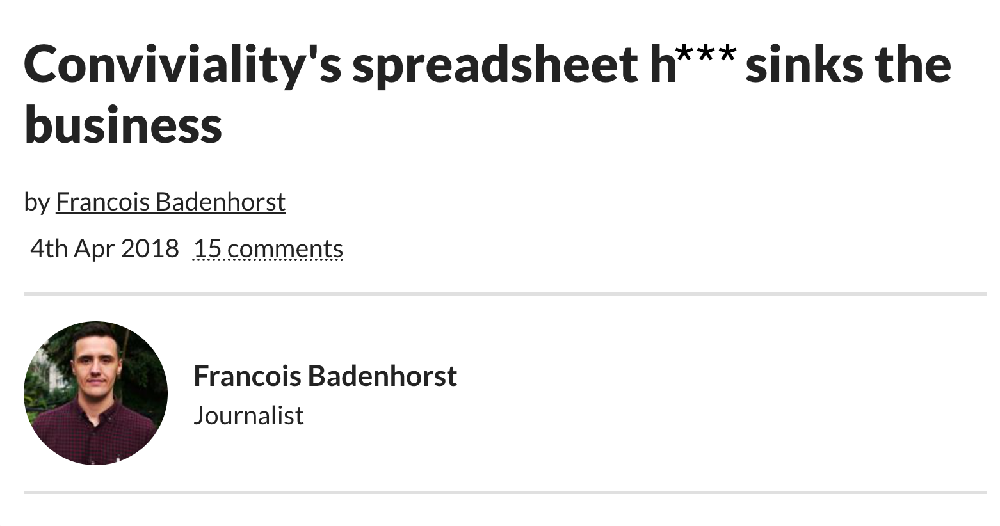
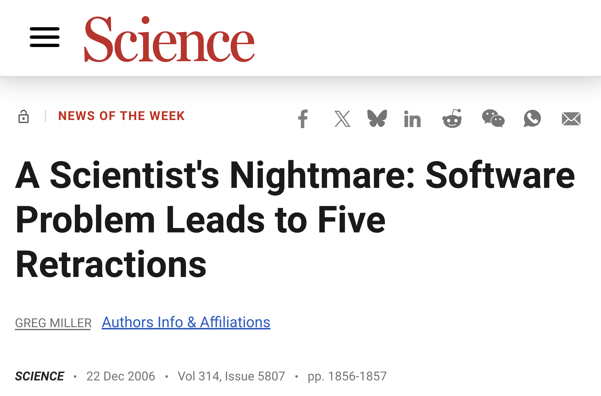
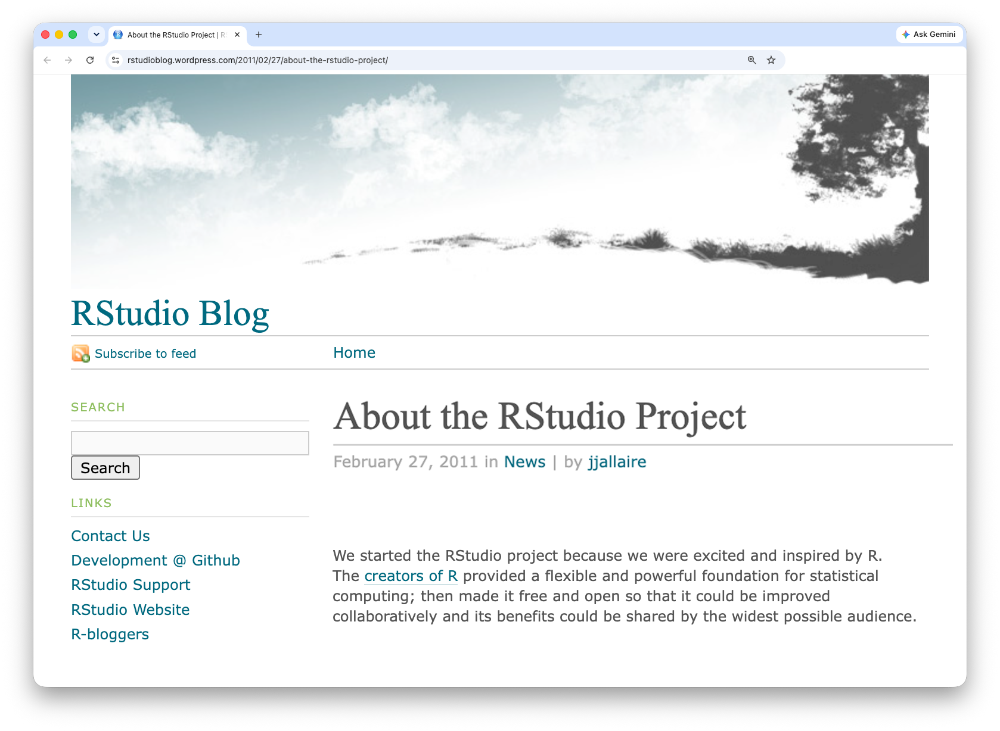
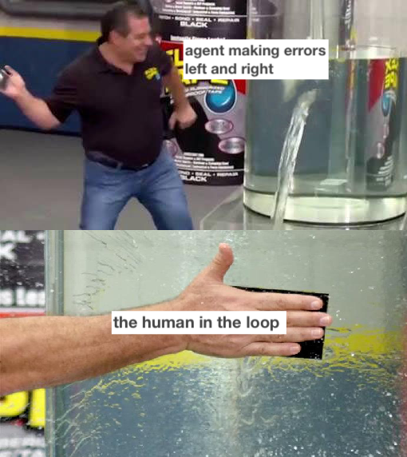
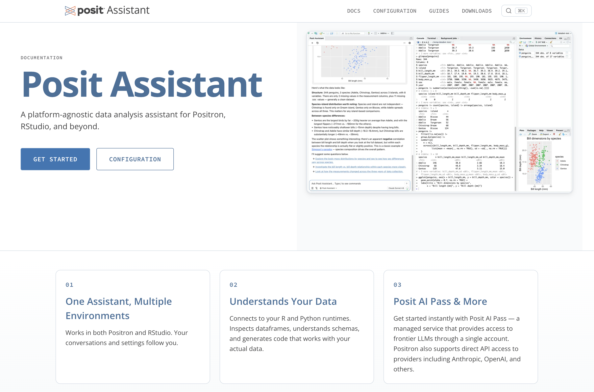
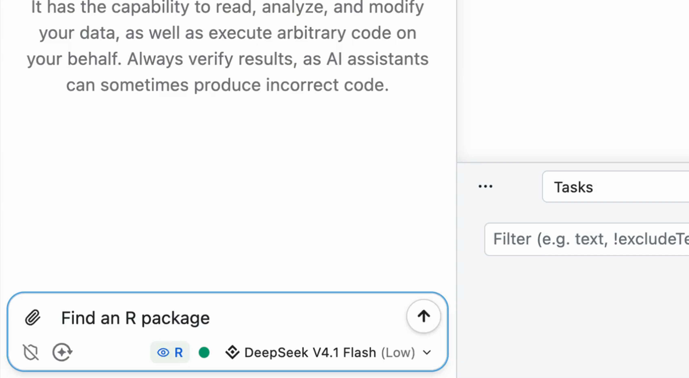
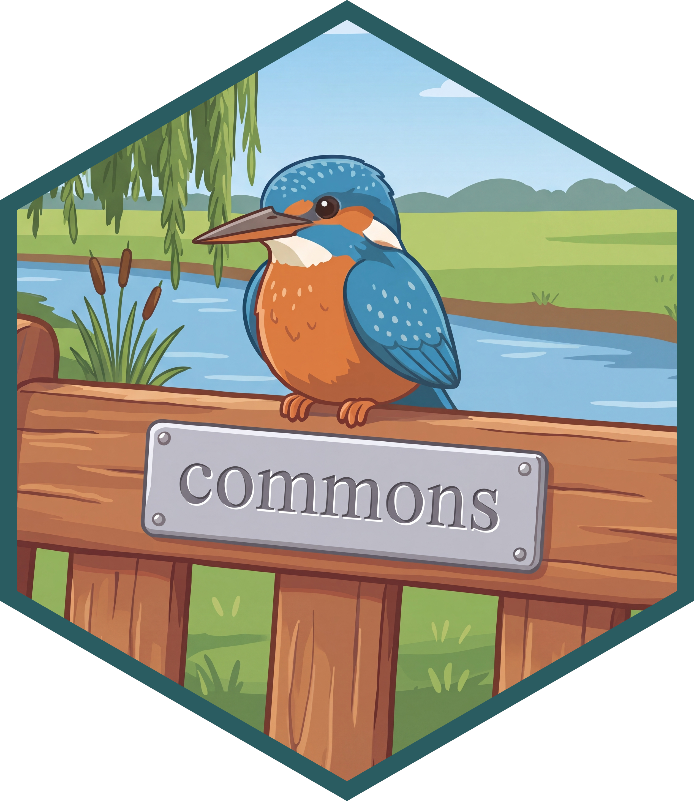
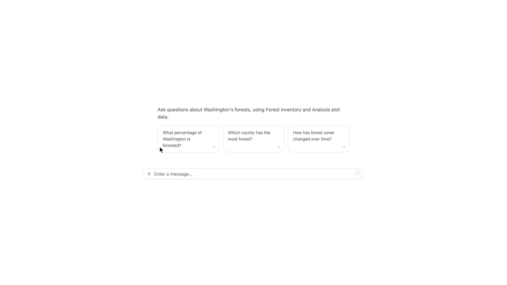

## {#title .title-slide .green-slide}

::: {.columns}

::: {.column width="68%"}
### Practical AI for data science {.talk-title}

::: {.talk-meta}
**Simon Couch**

uRos 2026
:::
:::

::: {.column width="32%"}
<div class="circle-pair circle-pair-overlap" aria-hidden="true"><span class="circle periwinkle-circle"></span><span class="circle orange-circle"></span></div>
:::

:::

::: {.footer .title-footer}
https://github.com/simonpcouch/uros-26
:::

## {#forest-share-naive .agent-story-slide .forest-story .slow-tool-calls}

```{=html}
<div class="agent-window">
  <div class="agent-thread">
        <div class="chat-turn chat-turn-user">
          <div class="chat-message chat-message-user">
            what percentage of Washington is forested?
          </div>
        </div>
        <div class="chat-turn chat-turn-agent tool-run fragment fade-up" data-fragment-index="0">
          <div class="chat-message chat-message-agent">
            <div class="agent-thinking"><span></span> Analyzing forest cover</div>
            <div class="tool-card" style="--tool-delay: 0s">
              <span class="tool-card-icon">⌕</span>
              <span><strong>Finding a relevant R package</strong><small>forested</small></span>
              <span class="tool-progress"><i class="tool-spinner"></i><i class="tool-check">✓</i></span>
            </div>
            <div class="tool-card code-card" style="--tool-delay: 2.25s">
              <span class="tool-card-icon">R</span>
              <div><code>table(forested$forested)</code><pre>#>  Yes   No
#> 3894 3213</pre></div>
              <span class="tool-progress"><i class="tool-spinner"></i><i class="tool-check">✓</i></span>
            </div>
            <div class="tool-card code-card" style="--tool-delay: 4.5s">
              <span class="tool-card-icon">R</span>
              <div><code>mean(forested$forested == "Yes")</code><pre>#> [1] 0.548</pre></div>
              <span class="tool-progress"><i class="tool-spinner"></i><i class="tool-check">✓</i></span>
            </div>
          </div>
        </div>
        <div class="chat-turn chat-turn-agent result-turn fragment fade-up" data-fragment-index="0">
          <div class="chat-message chat-message-agent">
            <p>About <strong>55%</strong> of Washington is forested, based on 7,107 Forest Service survey plots.</p>
          </div>
        </div>
  </div>
</div>
```

:::notes
This morning, a policy advisor in the U.S. opened up an LLM chat application and asked: what percentage of Washington is forested?

The agent finds some public data (an R package called forested), writes some code `mean(forested$forested == "Yes")`, and comes up with a number: 55%.

The state's last official figure was 59%, which is a few points higher. Oh, no! The state spends tens of millions of dollars funding an emergency replanting program to fix a forest loss that never happened.
:::

## {#forest-share-official .agent-story-slide .forest-story .slow-tool-calls}

```{=html}
<div class="agent-window">
  <div class="agent-thread">
    <div class="chat-turn chat-turn-user">
      <div class="chat-message chat-message-user">
        what percentage of Washington is forested? use the post-stratified estimator on only the 2025 data
      </div>
    </div>
    <div class="chat-turn chat-turn-agent tool-run fragment fade-up" data-fragment-index="0">
      <div class="chat-message chat-message-agent">
        <div class="agent-thinking"><span></span> Analyzing forest cover</div>
        <div class="tool-card code-card" style="--tool-delay: 0s">
          <span class="tool-card-icon">R</span>
          <div><code>d &lt;- dplyr::filter(forested, year == 2025)</code></div>
          <span class="tool-progress"><i class="tool-spinner"></i><i class="tool-check">✓</i></span>
        </div>
        <div class="tool-card code-card" style="--tool-delay: 1.75s">
          <span class="tool-card-icon">R</span>
          <div><code>pct_forested_post_stratified(d)</code><pre>#> # A tibble: 1 × 2
#>     pct    se
#>   &lt;dbl&gt; &lt;dbl&gt;
#> 1 0.592 0.009</pre></div>
          <span class="tool-progress"><i class="tool-spinner"></i><i class="tool-check">✓</i></span>
        </div>
      </div>
    </div>
    <div class="chat-turn chat-turn-agent result-turn fragment fade-up" data-fragment-index="0">
      <div class="chat-message chat-message-agent">
        <p>An estimated <strong>59.2%</strong> of Washington is forested (SE 0.9%), consistent with the last official figure of 59%.</p>
      </div>
    </div>
  </div>
</div>
```

:::notes
After the money is spent, an official at the U.S. forest service reruns their own analysis, which uses a post-stratified estimator to estimate the share. They calculate the figure as 59.2%, within noise of the previous figure.
:::

## {#test-set}

{.rounded}

:::notes
This is something that we've seen quite a bit internally at Posit, and also with many of the organizations we work with. It's becoming normal to vibe-analyze data.

The idea for this hypothetical came from this hilariously-titled episode of The Test Set podcast.
:::

## {#convenience-versus-correctness .quote-slide .paper-slide}

> In the battle between convenience and correctness, convenience is winning.
>
> <footer>Joe Cheng (CTO @ Posit)</footer>

::: notes
Posit's CTO recently summarized this trend like so:

It is true that AI has largely been a threat to correctness. A broader population of people can now convincingly do data analysis.

It just so happened that Joe said this a month ago, but he could have said it 6/7 years ago (ayyy) and it would still have been true.
:::

## {#conviviality-spreadsheet-error}

{.rounded .nostretch width="90%"}

:::footer
<span style="color:#ee6c55;">https://www.accountingweb.co.uk/business/management-accounting/convivialitys-spreadsheet-hell-sinks-the-business</span>
:::

::: notes
In 2019, Conviviality (a beverage company) discovered they had been mistakenly reporting healthy financials for years due to a “spreadsheet arithmetic error.”

> £5.2m of that £14m came thanks to “a material error in the financial forecasts”. The error, it later admitted, was “a spreadsheet arithmetic error”.
:::

## {#protein-modeling-software-error}

{.rounded .nostretch width="80%"}

:::footer
https://www.science.org/doi/10.1126/science.314.5807.1856
:::

:::notes
Or Joe could have said it 20 years ago, when it came to light that a whole subfield of protein modeling had been distracted by a bug in in-house, closed-source software.

From 2001 to 2006, Geoffrey Chang published a series of heavy-hitting papers that reshaped his field, while other labs struggled to reproduce their findings. The software that the Chang lab used to carry out the analysis contained a bug that flipped the sign of a computation. The bug came to light when another lab solved a similar protein structure and saw that it produced a near-mirror image of Chang's. At this point, the Chang lab checked their code, found the bug, and retracted 5 papers.
:::

## {#rstudio-project-blog}

. . .

{height="700" style="display: block; margin: 0 auto;"}

:::notes
I bring these examples up to say that there have always been threats to correctness in data analysis. This is why Posit was founded; correctness in high-stakes data analysis has always been our thing. But our stance is not "you need to forgo convenience in favor of correctess."

I was doing some research for this talk when I came across this old weblog...
:::

:::footer
rstudioblog.wordpress.com/2011/02/27/about-the-rstudio-project/
:::

## {#trustworthy-and-intuitive .quote-slide .compact-quote .paper-slide}

> Our goal is to develop a powerful tool that supports [trustworthy, high quality analysis]{.accent}.
>
> <br>
>
> At the same time, we want RStudio to be as [straightforward and intuitive]{.accent} as possible.
>
> <footer>JJ Allaire (Founder @ Posit), 2011</footer>

:::footer
https://rstudioblog.wordpress.com/2011/02/28/rstudio-new-open-source-ide-for-r/
:::

:::notes
He's saying "it can be correct _and_ convenient."

What if our stance was the same with AI? In other words, can we build data analysis agents that are both correct and convenient to use?
:::


# {#correct-and-convenient .correct-convenient-slide .paper-slide}

<div class="cc-wrap">
  <div class="circle-pair circle-pair-animated" aria-hidden="true"><span class="circle periwinkle-circle"></span><span class="circle orange-circle"></span><span class="fragment circle-overlap-trigger" data-fragment-index="0"></span></div>
  <div class="cc-text fragment fade-up" data-fragment-index="0">Correct and convenient</div>
</div>

```{r}
#| include: false
library(ggplot2)
library(dplyr)
library(forcats)
library(ggforce)
library(scales)

original_results_env <- new.env()
load("data/bluffbench-original-results.rda", envir = original_results_env)
bluffbench_original_results <- original_results_env$bluff_results

latest_results_env <- new.env()
load("data/bluffbench-latest-results.rda", envir = latest_results_env)
bluffbench_latest_results <- latest_results_env$bluff_results

bluff2_results_env <- new.env()
load("data/bluffbench2-latest-results.rda", envir = bluff2_results_env)
bluff2_latest_results <- bluff2_results_env$bluff2_results

bluffbench_results_theme <-
  theme_minimal(base_size = 22) +
  theme(
    plot.background = element_rect(fill = "#f3eee8", color = NA),
    panel.background = element_rect(fill = "#f3eee8", color = NA),
    legend.background = element_rect(fill = "#f3eee8", color = NA),
    legend.key = element_rect(fill = "#f3eee8", color = NA),
    panel.grid.minor = element_blank(),
    panel.grid.major = element_line(color = "#dedbd5"),
    text = element_text(color = "#3d2b45"),
    axis.text = element_text(color = "#3d2b45"),
    strip.background = element_blank(),
    strip.text = element_text(color = "#3d2b45", face = "bold"),
    plot.title.position = "plot"
  )

bluff2_summary <-
  bluff2_latest_results |>
  summarize(
    score = (sum(score == "C") + (sum(score == "P") * .5)) / n(),
    .by = model
  ) |>
  mutate(model = gsub(" (medium)", "", model, fixed = TRUE))
```


## {#bluffbench-counterintuitive-plot .paper-slide}

::: {.plot-slide-content .fragment data-fragment-index="0"}

```{r}
#| echo: false
#| fig-align: center
#| fig-alt: "A scatterplot of price against carat. The points form a clear negative association, with price generally falling as carat rises."
#| fig-width: 12
#| fig-height: 6
#| fig-bg: "#f3eee8"
#| out-width: "92%"
bluffbench_diamonds <- ggplot2::diamonds |>
  mutate(carat = max(carat) - carat)

ggplot(bluffbench_diamonds, aes(x = carat, y = price)) +
  geom_point(size = 3, alpha = 0.2) +
  theme(
    plot.background = element_rect(fill = "#f3eee8", color = NA),
    axis.title = element_text(size = 30, color = "#3d2b45"),
    axis.text = element_text(size = 22, color = "#3d2b45")
  )
```

:::

<div class="fragment fade-in-then-out plot-model-quote" data-fragment-index="1"><strong>Model:</strong> &ldquo;There&rsquo;s a strong positive relationship between carat and price!&rdquo;</div>

<div class="fragment plot-overlay-caption" data-fragment-index="2">Can models interpret plots that contradict their expectations?</div>

::: notes
around a year ago we did an experiment
we wanted to know how well models interpret plots
we showed them plots like this one, which plots diamonds and asked them to interpret them
and they said stuff like this: 
and that sounds good until you release: that is not ...

this is what we wanted to know: would models correctly interpret plots that contradicted their expectations?
:::

## November 2025 {#bluffbench-november-2025 .paper-slide}

::: {.plot-slide-content}

```{r}
#| echo: false
#| fig-align: center
#| fig-alt: "A horizontal stacked bar chart titled 'Models often report what they expect to see, not what's plotted.' GPT-5, Gemini Pro 2.5, and Claude Sonnet 4.5 are mostly incorrect."
#| fig-width: 12
#| fig-height: 7.5
#| fig-bg: "#f3eee8"
#| out-width: "70%"
bluffbench_original_results |>
  filter(type == "mocked") |>
  mutate(score = fct_recode(score, "Correct" = "C", "Incorrect" = "I")) |>
  ggplot(aes(y = model, fill = score)) +
  geom_bar(position = "fill") +
  scale_fill_manual(
    name = NULL,
    breaks = c("Correct", "Incorrect"),
    values = c("Correct" = "#79b8a8", "Incorrect" = "#ee6c55")
  ) +
  scale_x_continuous(labels = scales::percent) +
  labs(
    title = "Models often report what they expect to see, not what's plotted",
    subtitle = "With well-known datasets",
    x = NULL,
    y = NULL
  ) +
  bluffbench_results_theme +
  theme(
    plot.title = element_text(size = 26, face = "bold"),
    plot.subtitle = element_text(size = 18),
    axis.text.x = element_text(size = 18),
    axis.text.y = element_text(size = 20),
    legend.position = "top",
    legend.justification = "left",
    legend.text = element_text(size = 18)
  )
```

:::

:::footer
posit-dev.github.io/bluffbench
:::

::: notes
We tried a range of interventions to improve these scores, but none moved them
much. 
:::

## September 2026 {#bluffbench-september-2026 .paper-slide}

::: {.plot-slide-content}

```{r}
#| echo: false
#| fig-align: center
#| fig-alt: "A faceted horizontal stacked bar chart of percent correct across recent models, split into thinking and no-thinking groups. Thinking models perform better, while most models still give many incorrect answers."
#| fig-width: 12
#| fig-height: 7.5
#| fig-bg: "#f3eee8"
#| out-width: "70%"
bluffbench_latest_results |>
  filter(
    type == "mocked",
    release_date >= as.Date("2026-04-01")
  ) |>
  mutate(
    score = fct_recode(score, "Correct" = "C", "Incorrect" = "I"),
    pct_correct = ave(score == "Correct", model, FUN = mean),
    model = gsub(" \\((medium|non-thinking)\\)$", "", model),
    model = reorder(model, pct_correct),
    thinking = factor(
      ifelse(thinking, "Thinking", "No thinking"),
      levels = c("Thinking", "No thinking")
    )
  ) |>
  filter(thinking == "Thinking") |>
  ggplot(aes(y = model, fill = score)) +
  geom_bar(position = "fill") +
  scale_fill_manual(
    name = NULL,
    values = c("Correct" = "#79b8a8", "Incorrect" = "#ee6c55")
  ) +
  scale_x_continuous(labels = scales::percent) +
  labs(
    title = "Models got better at interpreting counterintuitive plots",
    x = "Percent correct",
    y = NULL
  ) +
  bluffbench_results_theme +
  theme(
    plot.title = element_text(size = 26, face = "bold"),
    axis.text.x = element_text(size = 18),
    axis.text.y = element_text(size = 14),
    axis.title.x = element_text(size = 22),
    strip.text = element_text(size = 22, hjust = 0),
    legend.position = "none",
    plot.margin = margin(5.5, 5.5, 15, 5.5)
  )
```

:::

:::footer
posit-dev.github.io/bluffbench
:::

::: notes
until we waited 6 months

these are results from now
:::


## {#bluffbench2-data-artifact .paper-slide}

::: {.plot-slide-content}

```{r}
#| echo: false
#| fig-align: center
#| fig-alt: "A scatterplot of sleep hours against stress score with a negative trend. A subset of points falls exactly along a straight line, suggesting a data-quality artifact."
#| fig-width: 12
#| fig-height: 6
#| fig-bg: "#f3eee8"
#| out-width: "92%"
set.seed(617)

n <- 150
n_imp <- 35
sleep_hours <- round(runif(n, 4, 10), 1)
stress_score <- round(
  pmin(pmax(95 - 7.5 * sleep_hours + rnorm(n, 0, 8), 5), 95),
  1
)

imp_sleep <- round(runif(n_imp, 4.5, 9.5), 1)
imp_stress <- round(95 - 7.5 * imp_sleep, 1)

wellbeing_data <- data.frame(
  sleep_hours = c(sleep_hours, imp_sleep),
  stress_score = c(stress_score, imp_stress)
)

ggplot(wellbeing_data, aes(x = sleep_hours, y = stress_score)) +
  geom_point(alpha = 0.8, size = 3) +
  labs(x = "sleep (hours)", y = "stress score") +
  theme(
    plot.background = element_rect(fill = "#f3eee8", color = NA),
    axis.title = element_text(size = 30, color = "#3d2b45"),
    axis.text = element_text(size = 22, color = "#3d2b45")
  )
```

:::

:::footer
github.com/posit-dev/bluffbench2
:::

::: notes
we showed them plots that look like this
take a look at this plot. what do you notice?

one thing that flags my attention is these points through the middle of the cloud that fall exactly on a straight line. this is something i might want to dig into further and make sure nothing strange was happening in the underlying data.

we wanted to see if models would be able to pick up on this kind of subtle visual artifact
:::

## {#bluffbench2-results .paper-slide}

::: {.plot-slide-content}

```{r}
#| echo: false
#| fig-align: center
#| fig-alt: "A horizontal bar chart of bluffbench2 scores by model. Every model scores below 50 percent, showing that frontier models still struggle to notice subtle data-quality issues."
#| fig-width: 12
#| fig-height: 7
#| fig-bg: "#f3eee8"
#| out-width: "78%"
bluff2_summary |>
  mutate(model = fct_reorder(model, score)) |>
  ggplot() +
  aes(x = score, y = model) +
  geom_col(fill = "#ac5f9b") +
  scale_x_continuous(labels = label_percent(), limits = c(0, 1)) +
  labs(
    x = "Score",
    y = NULL,
    title = "Frontier models still struggle to notice subtle data quality issues"
  ) +
  bluffbench_results_theme +
  theme(
    plot.title = element_text(size = 26, face = "bold"),
    axis.text.y = element_text(size = 22),
    axis.text.x = element_text(size = 20)
  )
```

:::

:::footer
github.com/posit-dev/bluffbench2
:::

::: notes
even frontier models don't do very well
so they've gotten better, but it's not like they've solved data science and don't make mistakes
they still fail at this task and others that are likely to come up in data science workflows

but there's another problem
:::

# {#subhuman-on-some-tasks .statement-slide .paper-slide}

::: {.statement}
Large language models are still [meaningfully subhuman]{.accent} on some data science tasks.
:::

# {#context-outside-the-data .statement-slide .paper-slide}

::: {.statement}
Data analysis depends on [context]{.accent} that is not in the data.
:::

::: notes
but there is a second problem: data analysis depends on context that is not in the data

all data is constructed, and it is often meaningless without its context

that context might live in documentation files, in data dictionaries, in semantic views, or in the mind of your coworker who's been at the organization for 20 years and knows absolutely everything but has never written anything down

it's not that this information is impenetrable to an llm...but...

so the models got better, but they still aren't perfect they are going to make mistakes
so if we are going to use AI for data analysis, the question becomes...
:::

# {#correct-ai-analysis .header-slide .blue-slide}

::: {.columns}

::: {.column .header-text width="64%"}
How do we make AI-involved analysis correct?
:::

::: {.column width="36%"}
{.header-image fig-alt="Orange shield"}
:::

:::

## {#human-in-the-loop-intro}

# {#human-in-the-loop .paper-slide .diagram-slide}



::: notes
- Here’s a common thought about AI
  - It’s untrustworthy, but useful.
  - To make it trustworthy, we need people to verify the output from or supervise agents.

it is an intuitively appealing division of labor. the agent does what it's good at, the human provides the judgment to keep it from going off the rails.
:::

## {#slap-a-human-on-it .paper-slide}

::: {style="display: flex; height: 100%; flex-direction: column; align-items: center; justify-content: center; gap: 0.75rem;"}
{style="width: auto; max-height: 600px; margin: 0; border-radius: 0.75rem;"}

<div class="fragment" style="min-height: 1.15em; margin: 0; font-size: 1em; line-height: 1.15;">*the <strong>slap a human on it</strong> approach</div>
:::

::: notes
this sounds so nice! it's really tempting to just do this everything and call it a day

the human is there to prevent mistakes and all will be good. 

I like to call this simplistic division of labor the "slap a human on it" approach. we're not really thinking about what the human will do or how exactly, but we are glad they are there and just hope for the best

and I'm being a bit facetious but ...
:::

# {#human-ai-evidence .paper-slide .hitl-evidence-slide}

::: {.hitl-evidence-heading}
Adding a human [does not guarantee]{.accent} a better result.
:::

::: {.hitl-evidence-points .incremental}
- Human–AI combinations do not reliably outperform the better of the two.
- Approval fatigue.
- Trust, timing, cognitive load, social cues, and information design all shape decisions.
:::

::: {.footer .hitl-footer}
[Vaccaro et al. (2024)](https://doi.org/10.1038/s41562-024-02024-1); [Crootof et al. (2023)](https://scholarship.law.vanderbilt.edu/vlr/vol76/iss2/2/); Anthropic (2026) [[1]](https://claude.com/blog/auto-mode-default-in-claude-code) [[2]](https://www.anthropic.com/engineering/claude-code-auto-mode)
:::

::: notes

this does not mean every human-AI team is worse. it means that adding a human does not automatically produce a better system

people get tired of approving things

approval fatigue can be a big issue
think about your own coding agent. when it asks you to approve a command, how often do you carefully read it, and how often do you just hit accept?

trust, timing, cognitive load, social cues, the interface, and the amount of information all affect how someone decides whether code or an action is correct or safe

full citations, in case anyone asks:
- Vaccaro, M., Almaatouq, A., & Malone, T. W. (2024). ["When combinations of humans and AI are useful: A systematic review and meta-analysis."](https://doi.org/10.1038/s41562-024-02024-1) *Nature Human Behaviour, 8*, 2293–2303.
- Crootof, R., Kaminski, M. E., & Price, W. N., II. (2023). ["Humans in the Loop."](https://scholarship.law.vanderbilt.edu/vlr/vol76/iss2/2/) *Vanderbilt Law Review, 76*, 429.
- Hughes, J. (2026, March 25). ["How we built Claude Code auto mode: A safer way to skip permissions."](https://www.anthropic.com/engineering/claude-code-auto-mode) Anthropic.
- Phillippi, C. (2026, August 7). ["Auto mode is now the default in Claude Code for Pro, Max, and Team plans."](https://claude.com/blog/auto-mode-default-in-claude-code) Claude by Anthropic.
:::

# {#people-are-not-fixed .statement-slide .paper-slide}

::: {.statement}
People are [not fixed safety components.]{.accent}
:::

::: notes
because people are not fixed safety components 
we can't just slot them in whenever we are worried an agent system might be wrong

that doesn't mean they shouldn't be there! but we need to go further 
:::

# {#design-the-entire-system .beat-slide}

[How do we design the entire system to produce correct work?]{.fragment}

::: notes
the question is how we design the interaction and the entire system so that human expertise can actually support correctness
:::

# {#agent-correctness-goals .statement-slide .paper-slide}

::: {.bullet-replace}

::: {.statement .regular-weight .replace-parents .fragment .fade-out data-fragment-index="0"}
Build trust and correctness into the agents themselves<br><br>
Consider how the agent will interact with the user and support their expertise
:::

::: {.statement .regular-weight .replace-subs .fragment data-fragment-index="0"}
Help the agent be correct<br><br>
Make it less bad when the agent is wrong
:::

:::

::: notes 
these end up mapping onto two principles that we're going to get coming back to
help the agent...

but we know it's going to make mistakes, so

make it less bad...
:::

## {#posit-assistant .blue-slide .posit-assistant-blue-slide}

{.rounded .nostretch height="650"}

:::notes
Our flagship agent is Posit Assistant. Posit Assistant is a coding and data science agent. It's available in RStudio, Positron, and the terminal. When it's running inside of your IDE, it works inside of your active R and Python session. You can use whatever model from whatever provider you want with it.
:::

:::footer
assistant.posit.co
:::

## {#flight-delay-demo}

:::notes
In thinking through how to demo out Posit Assistant, I thought about how Sara described her first moments of really getting the hang of data science tools as like seeing below the surface. I think many of us might have had a moment like this at some point, when we began to understand how powerful data science and statistics are for answering questions about the world.

The first time I felt this way, I had been asked to use R to understand what affects flight delays. I had to load in some data and then write dplyr and ggplot to see if I could make any decisions that would give me better chances of my flight leaving on time. 

In demoing Posit Assistant, I thought I might revisit that moment with you. 
:::

## {#posit-assistant-web-fetch-start}

{.rounded .nostretch width="100%"}

## {#posit-assistant-web-fetch}

<video class="rounded click-to-toggle" width="100%" preload="auto" data-autoplay tabindex="0" aria-label="Click to play or pause">
  <source src="figures/pa-01-webfetch-a.mp4">
</video>

:::notes
I'm in Positron, with Posit Assistant pulled up on the left hand side and a live R session. I'll start off by asking the agent about R packages that could help me grab data on flights.

...

It can do normal coding agent stuff
:::

## {#posit-assistant-web-fetch-b}

<video class="rounded click-to-toggle" width="100%" preload="auto" data-autoplay tabindex="0" aria-label="Click to play or pause">
  <source src="figures/pa-01-webfetch-b.mp4">
</video>

## {#posit-assistant-docs}

<video class="rounded click-to-toggle" width="100%" preload="auto" data-autoplay tabindex="0" aria-label="Click to play or pause">
  <source src="figures/pa-02-docs-a.mp4">
</video>

:::notes
It can read documentation (in the same way that you would, too)

Also, note that it preferred to keep data in the file system
:::

## {#posit-assistant-docs-b}

<video class="rounded click-to-toggle" width="100%" preload="auto" data-autoplay tabindex="0" aria-label="Click to play or pause">
  <source src="figures/pa-02-docs-b.mp4">
</video>

## {#posit-assistant-clean-data}

<video class="rounded click-to-toggle" width="100%" preload="auto" data-autoplay tabindex="0" aria-label="Click to play or pause">
  <source src="figures/pa-03-clean-data-a.mp4">
</video>

:::notes
* Cleaning mode: we felt that most coding agents had a superficial relationship with data quality
* It pays attention to missing data, outliers, etc
* Cleaning script is persisted
:::

## {#posit-assistant-clean-data-b}

<video class="rounded click-to-toggle" width="100%" preload="auto" data-autoplay tabindex="0" aria-label="Click to play or pause">
  <source src="figures/pa-03-clean-data-b.mp4">
</video>

## {#posit-assistant-clean-data-c}

<video class="rounded click-to-toggle" width="100%" preload="auto" data-autoplay tabindex="0" aria-label="Click to play or pause">
  <source src="figures/pa-03-clean-data-c.mp4">
</video>

## {#posit-assistant-clean-data-d}

<video class="rounded click-to-toggle" width="100%" preload="auto" data-autoplay tabindex="0" aria-label="Click to play or pause">
  <source src="figures/pa-03-clean-data-d.mp4">
</video>

## {#posit-assistant-carriers}

<video class="rounded click-to-toggle" width="100%" preload="auto" data-autoplay tabindex="0" aria-label="Click to play or pause">
  <source src="figures/pa-05-plot-a.mp4">
</video>

:::notes
You can see plots

The agent shows restraint in interpretation; is concerned about sample sizes before interpreting this anomoly in the plot
:::

## {#posit-assistant-carriers-b}

<video class="rounded click-to-toggle" width="100%" preload="auto" data-autoplay tabindex="0" aria-label="Click to play or pause">
  <source src="figures/pa-05-plot-b.mp4">
</video>

## {#posit-assistant-carriers-c}

<video class="rounded click-to-toggle" width="100%" preload="auto" data-autoplay tabindex="0" aria-label="Click to play or pause">
  <source src="figures/pa-05-plot-c.mp4">
</video>

## {#posit-assistant-carriers-d}

<video class="rounded click-to-toggle" width="100%" preload="auto" data-autoplay tabindex="0" aria-label="Click to play or pause">
  <source src="figures/pa-05-plot-d.mp4">
</video>

## {#posit-assistant-report}

<video class="rounded click-to-toggle" width="100%" preload="auto" data-autoplay tabindex="0" aria-label="Click to play or pause">
  <source src="figures/pa-06-report.mp4">
</video>

:::notes
Slash commands (has a bunch of specialized skills) + can write quarto reports
:::

## {#posit-assistant-model-cost}

<video class="rounded click-to-toggle" width="100%" preload="auto" data-autoplay tabindex="0" aria-label="Click to play or pause">
  <source src="figures/pa-08-model-cost.mp4">
</video>

:::notes
Now, this is the end of my demo of Posit Assistant. I do have one more thing I want to call out, though.

The whole conversation was 5 cents. Part of our mission is providing the best tools to folks regardless of their economic means, and we remain committed to that. Totally free usage is not possible—AI inference is quite expensive—but Posit Assistant is token efficient, and we've worked hard to serve incredibly cheap and capable open-weights models with strong privacy guarantees for people that use our Posit AI Pass subscription. Per token, this model, GLM 5.3 Flash, is less than a thirtieth of the price of Claude Opus 5, and is served under Zero Data Retention.
:::


# {#posit-assistant-correctness .statement-slide .paper-slide}

::: {.statement .regular-weight}
Help the agent be correct [**by encouraging sound statistics and reproducibility practices**]{.fragment}<br><br> 
Make it less bad when the agent is wrong [**by making good use of your expertise and sharing an R/Python environment**]{.fragment}
:::

:::notes
Let's revisit those lessons learned on agent-building from Sara. She said we ought to Help the agent be correct, and make it less bad when the agent is wrong.

Much of helping the model not be wrong is by asking nicely :) We tell it to approach data analysis with an openness to uncertainty, we tell it work in persistent files, we tell it to take data cleanliness seriously.

Various elements of Posit Assistant help you and the agent have a richer collaboration. Data cleaning mode loops you in on important decisions that affect interpretation. We show you plots because our bluffbench evaluations show we can't trust the models to interpret models well. We place you and the agent in the same computational environment so that, when things go wrong, you can quickly get on the same page and see eye-to-eye.

That said, what about people that don't have data expertise and don't know how to write R or Python code?
:::

# {.paper-slide}

::: notes
posit assistant assumes you are a data scientist
who wants to work in an ide
:::

# But what if the user is not a data scientist? {#non-data-scientist .blue-slide}

::: notes
but what if the user is not a data scientist?
how do we help them get correct answers too?
:::

## {#forest-share-reminder .agent-story-slide .forest-story .played-through}

```{=html}
<div class="agent-window">
  <div class="agent-thread">
    <div class="chat-turn chat-turn-user">
      <div class="chat-message chat-message-user">
        what percentage of Washington is forested?
      </div>
    </div>
    <div class="chat-turn chat-turn-agent tool-run">
      <div class="chat-message chat-message-agent">
        <div class="tool-card">
          <span class="tool-card-icon">⌕</span>
          <span><strong>Finding a relevant R package</strong><small>forested</small></span>
          <span class="tool-progress"><i class="tool-spinner"></i><i class="tool-check">✓</i></span>
        </div>
        <div class="tool-card code-card">
          <span class="tool-card-icon">R</span>
          <div><code>table(forested$forested)</code><pre>#>  Yes   No
#> 3894 3213</pre></div>
          <span class="tool-progress"><i class="tool-spinner"></i><i class="tool-check">✓</i></span>
        </div>
        <div class="tool-card code-card">
          <span class="tool-card-icon">R</span>
          <div><code>mean(forested$forested == "Yes")</code><pre>#> [1] 0.548</pre></div>
          <span class="tool-progress"><i class="tool-spinner"></i><i class="tool-check">✓</i></span>
        </div>
      </div>
    </div>
    <div class="chat-turn chat-turn-agent result-turn">
      <div class="chat-message chat-message-agent">
        <p>About <strong>55%</strong> of Washington is forested, based on 7,107 Forest Service survey plots.</p>
      </div>
    </div>
  </div>
</div>
```

::: notes
let's go back to that policy advisor
easy to say...
but they are curious too! they had a question and reached for the tool that was accessible to them. 

Unfortunately, the answer they got was wrong.

A raw mean over every plot in every year isn't how the Forest Service estimates forest cover...their statisticians have code they use to compute the post-stratified estimate that gives them the correct results, and they vet and maintain this
:::

# [_Trusted_ code]{#trusted-code style="color: #ee6c55; font-size: 1.4em;"}

::: notes
This vetted code used by the data scientists is what we'll called _trusted_ code
they rely on it and trust it to give them the right answers

They also might have trusted code in

* Shiny apps
* R and Python packages
* Quarto documents

Instead of the model writing code afresh every time it's answering a question, what if it could discover and use this trusted code?

This is one of the core ideas behind a new open source package that we're excited to share with you all today. It's called commons.
:::

# {#commons .commons-intro-slide}

{.commons-intro-logo .nostretch fig-alt="Commons logo"}

:::footer
https://pos.it/commons
:::

::: notes
commons helps data scientists build trustworthy data agents for their collaborators.

It's an open source R and Python package built on `ellmer` / `chatlas` and `shinychat`. You can use it with whatever model from whatever provider you want.

and it's a bird because...
:::

## {#commons-trusted-calculation-start}

{.rounded .nostretch width="100%"}

## {#commons-trusted-calculation}

<video class="rounded click-to-toggle" width="100%" preload="auto" data-autoplay tabindex="0" aria-label="Click to play or pause">
  <source src="figures/commons-01-forest-share-a.mp4">
</video>

::: notes
let's see how the policy advisor's question would work with a commons agent

The first thing the agent does it search for a trusted calculation. Here it
finds and runs the Forest Service's post-stratified estimator from the green book

the answer is marked as trusted to signify that it used vetted code
:::

## {#commons-trusted-calculation-b}

<video class="rounded click-to-toggle" width="100%" preload="auto" data-autoplay tabindex="0" aria-label="Click to play or pause">
  <source src="figures/commons-01-forest-share-b.mp4">
</video>

## {#commons-trusted-calculation-c}

<video class="rounded click-to-toggle" width="100%" preload="auto" data-autoplay tabindex="0" aria-label="Click to play or pause">
  <source src="figures/commons-01-forest-share-c.mp4">
</video>

## {#commons-trusted-calculation-d}

<video class="rounded click-to-toggle" width="100%" preload="auto" data-autoplay tabindex="0" aria-label="Click to play or pause">
  <source src="figures/commons-01-forest-share-d.mp4">
</video>

## {#commons-lower-trust-answer}

<video class="rounded click-to-toggle" width="100%" preload="auto" data-autoplay tabindex="0" aria-label="Click to play or pause">
  <source src="figures/commons-02-column-mean-a.mp4">
</video>

::: notes
However, its unlikely that this trusted code will cover all questions a user might have. Here, the advisor asks about the mean of the whole column—there's no trusted calculation for that.
For these situations, the agent can write custom r, python, or sql.

In this case, the model doesn't find trusted context to justify its approach, so we mark the answer with this little yellow tag, which lets the user know that this answer should be considered less trusted.

This is how we've chosen to balance convenience and correctness. The tool has to feel convenient enough that the user actually wants to reach for it. Basically, it needs to feel like a normal chat. In the situation where we suspect the correctness is similar to a normal coding agent, we signal to the user that they ought to be more skeptical of this answer.
:::

## {#commons-lower-trust-answer-b}

<video class="rounded click-to-toggle" width="100%" preload="auto" data-autoplay tabindex="0" aria-label="Click to play or pause">
  <source src="figures/commons-02-column-mean-b.mp4">
</video>

## {#commons-context-citations}

<video class="rounded click-to-toggle" width="100%" preload="auto" data-autoplay tabindex="0" aria-label="Click to play or pause">
  <source src="figures/commons-03-official-gap-a.mp4">
</video>

::: notes
There's one more possible path. When the advisor asks why the two numbers differ, the agent will first look through additional context in the form of data dictionaries, markdown files (here, the green book and the papers cited in the forested docs), and, if you have them, existing context layers from Databricks and Snowflake.

Then, it will write whatever code it needs to to find an answer.

Finally, when it presents an answer, it can provides a citation to that context. That citation will be deterministically checked against trusted context that has appeared so far in the conversation—if it matches, this citation tag will be shown.

:::

## {#commons-context-citations-b}

<video class="rounded click-to-toggle" width="100%" preload="auto" data-autoplay tabindex="0" aria-label="Click to play or pause">
  <source src="figures/commons-03-official-gap-b.mp4">
</video>

## {#commons-trust-flow .trust-flow-slide .paper-slide}

<br>

```{=html}
<div class="trust-flow" role="img" aria-label="Commons searches trusted calculations, then marks answers based on whether they use a trusted calculation or a lower-trust custom path.">
  <div class="trust-tool trust-search">Search trusted calculations</div>
  <div class="trust-route-labels" aria-hidden="true">
    <span><span>Find one</span><span class="trust-decision-arrow">↓</span></span>
    <span><span>Don’t find one</span><span class="trust-decision-arrow">↓</span></span>
  </div>
  <div class="trust-branches">
    <div class="trust-branch trust-branch-high">
      <div class="trust-tool">Run trusted calculation</div>
      <span class="trust-down-arrow" aria-hidden="true">↓</span>
      <div class="trust-marker">
        
      </div>
    </div>
    <div class="trust-branch trust-branch-lower">
      <div class="trust-tool">Search context</div>
      <span class="trust-down-arrow" aria-hidden="true">↓</span>
      <div class="trust-tool">Write SQL/R/Python</div>
      <div class="trust-citation-routes" aria-hidden="true">
        <span><span>Cite</span><span class="trust-decision-arrow">↓</span></span>
        <span><span>Don’t cite</span><span class="trust-decision-arrow">↓</span></span>
      </div>
      <div class="trust-lower-outcomes">
        <div class="trust-marker">
          
        </div>
        <div class="trust-marker">
          
        </div>
      </div>
    </div>
  </div>
</div>
```

::: notes
Commons records which tools produced the answer. Trust is based on that
execution path, not on the model's confidence in its own answer. trust is deterministic

The citation itself is checked against trusted context. A custom answer is not
promoted merely because the model says it used a trusted source.
:::

## {#commons-lifecycle .lifecycle-slide .paper-slide}

::: {.lifecycle-cards}
::: {.lifecycle-card .fragment .fade-up}
### Build

You construct the agent by hooking it up to trusted code.
:::

::: {.lifecycle-card .fragment .fade-up}
### Deploy

Your colleagues use the agent deployed on Connect.
:::

::: {.lifecycle-card .fragment .fade-up}
### Improve

You review the agent's behavior, adding trusted code to cover common use cases.
:::
:::

::: notes
So far, we've only focused on the experience of the VP. I talked about how this was a tool for data scientists, so let's take a step and see what it looks like from yall's perspective.

Remember when Sara showed you the simple loop? Working with commons is more like three loops.

1. build: encode trusted calculations and context
  After installing the package, you point the commons agent at all of your trusted code. Shiny apps, R and Python libraries, Quarto docs, or existing semantic layers in Snowflake and Databricks
  Notably, you are not defining system prompts or tool definitions. commons ships with its own harness.
2. deploy: agent answers through the trusted or custom path
  Apps deploy to Connect like any Shiny app 
  The agent runs R and Python code in a sandbox so that it can be safely deployed
3. improve: review behavior and update the layers
  With the newest Connect release, once you and your admin opt-in, conversation histories will be stored with a native OpenTelemetry integration. 
  After the app has been deployed, you can read in conversation histories and find common use cases where the agent has to improvise an approach. Based on those findings, you can revisit step 1, providing more trusted code to the agent.
:::

# {#commons-correctness .statement-slide .paper-slide}

::: {.statement .regular-weight}
Help the agent be correct [**with trusted calculations and context**]{.fragment}<br><br>
Make it less bad when the agent is wrong [**by signaling trust and introducing feedback loops**]{.fragment}
:::

:::notes
Let's revisit those guidelines one more time.
:::

# {#commons-momentous .beat-slide}

::: {.momentous-row}
{.nostretch fig-alt="Commons logo"}

[pos.it/commons](https://pos.it/commons)
:::

::: notes
thank you and momentous feelings
:::

# {#conclusion .beat-slide .conclusion-thesis-slide}

It's (still) very bad to be wrong

::: notes
this was actually a prototype title for like three versions of this talk ago ago...
it's now incredibly easy to ask an agent a question about your data and get a wrong answer that looks completely plausible

the problem is not only that the answer is wrong. we may also be unable to tell how it was calculated or reproduce it

and if these answers are fast and convenient enough, we may start to tolerate that loss of correctness and trust as the price of using AI

but Posit has always built tools to support correct analysis. we do not think that standard should change just because the interface has changed

and it really still is bad to be wrong! correct answers, and correct answers whose methodology we can see and reproduce, are still important
:::

# {#conclusion-infrastructure .beat-slide .conclusion-thesis-slide}

::: {.conclusion-thesis}
AI has expanded who can get answers from data.

That changes the infrastructure we need for correct, transparent, and reproducible analysis.
:::

::: notes
and this is the part we find really motivating

AI has expanded who can ask questions about data and get answers directly. that changes the infrastructure we need around those answers

with Commons, a data team establishes which code and calculations it trusts and provides the organizational context the agent needs

the team can then give that agent to someone who might otherwise do a vibe analysis. that person keeps the convenience of asking questions in natural language, but the answers are grounded in the data team's trusted work and can be traced and reproduced

and that is where all of you data people come in. this infrastructure has to be built by people who understand the data, the calculations, and the organization

Commons is the package that helps you build it and make it available to others
:::


# {#thank-you .thank-you-slide .green-slide}

```{=html}
<div class="thank-you-wrap">
  <div class="thank-you-row">
    <h1>Thank you!</h1>
  </div>
  <div class="thank-you-resources">
    <a class="thank-you-resource thank-you-link-card thank-you-slides-card" href="https://github.com/simonpcouch/uros-26">
      <span class="thank-you-resource-label">Slides</span>
      <span class="thank-you-resource-link">github.com/simonpcouch/uros-26</span>
    </a>
    <a class="thank-you-resource thank-you-link-card thank-you-commons-card" href="https://pos.it/commons">
      <span class="thank-you-resource-label">Commons</span>
      <span class="thank-you-resource-link">pos.it/commons</span>
    </a>
    <a class="thank-you-resource thank-you-link-card thank-you-newsletter-card" href="https://pos.it/ai-newsletter">
      <span class="thank-you-resource-label">AI Newsletter</span>
      <span class="thank-you-resource-link">pos.it/ai-newsletter</span>
    </a>
  </div>
</div>
```

::: notes
we will be in the lounge
:::
